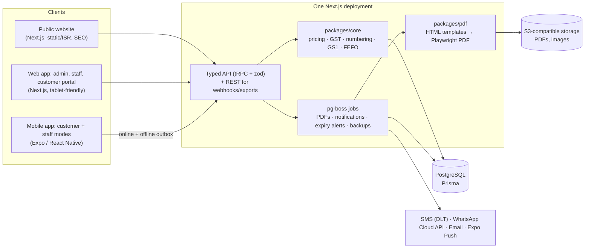

# Stack & architecture (proposal)

I'm keeping the stack suggested in the brief, with three changes, each explained below.

## Choices

| Layer | Choice | Why |
|---|---|---|
| Repo | **pnpm + Turborepo monorepo**: `apps/web`, `apps/mobile`, `packages/db`, `packages/core`, `packages/pdf`, `packages/ui` | The web app, mobile app and PDF generator all use the same pricing and GST code, so the numbers match everywhere. |
| Web | **Next.js (App Router)**: public site, admin/staff app and customer portal as route groups in **one** app | One deployment. The public pages are static/ISR, so they are fast and SEO-friendly. The app pages are responsive down to a counter tablet. |
| API | **Next.js route handlers with tRPC + zod**, plus a few REST endpoints (webhooks, Excel export, Tally XML later) | *Change 1: no separate NestJS service.* For a team this size, NestJS is one more thing to deploy for little gain. tRPC gives both the web app and the Expo app end-to-end types. Roles and permissions are checked in one middleware layer on the server. |
| DB | **PostgreSQL + Prisma** | As suggested. The schema lives in `packages/db/prisma/`. Managed Postgres with point-in-time recovery, **plus** a nightly `pg_dump` to S3, covers the daily backup requirement. |
| Background jobs | **pg-boss** (job queue stored in Postgres) | *Change 2: no Redis.* PDF rendering, WhatsApp/SMS/email, expiry alerts and backups run off the request path, so scanning stays under 300 ms. |
| PDF | **HTML templates → Playwright (Chromium) PDF** | As suggested. The invoice mock-up in `design/invoice-mockup/` is already this pipeline, including pagination with a repeated header, so the approved layout becomes the production template unchanged. |
| Mobile | **Expo (React Native)** with `expo-camera` (Code 128, QR, EAN, GS1 DataMatrix), **SQLite catalogue cache + outbox** for weak signal, Expo Push, EAS builds | One codebase for Android and iOS. Offline scans are queued with a `clientRequestId`, so syncing never creates a duplicate. |
| Barcodes & labels | **bwip-js** (Code 128 / QR / DataMatrix), labels as exact-mm HTML print pages (50×25, 38×25, A4 sheet) | Works with any thermal printer that has a driver. ZPL output for Zebra printers can be added later if needed. |
| Excel | **exceljs** | Price import/export, GST reports and the sales register for the accountant. |
| Auth | Session cookies (web) and tokens (app), **argon2id** passwords, **OTP via an Indian DLT-registered SMS provider** (e.g. MSG91) or WhatsApp | Indian SMS rules require DLT-registered templates for OTP and transactional messages. |
| Hosting | *Change 3:* host **in India (AWS ap-south-1 Mumbai or similar)**: app container + managed Postgres + S3 | Data stays in India, latency to customers is low, and backups are managed. |

## Money, dates, tax: rules in `packages/core`

- Amounts are stored as `Decimal(14,2)`. They are displayed with `en-IN` grouping (1,00,000.00) and as "INR … Only" in lakh/crore words.
- Dates are displayed as DD-MM-YYYY in Asia/Kolkata and stored in UTC.
- GST is calculated per HSN + rate group on the taxable value, the same way Tally does it, so the HSN summary always matches the tax lines. Round-off is to the nearest rupee.
- Intra-state vs inter-state is decided by comparing the company's state code with the place of supply.
- The financial year runs April–March, and document numbers restart each year.
