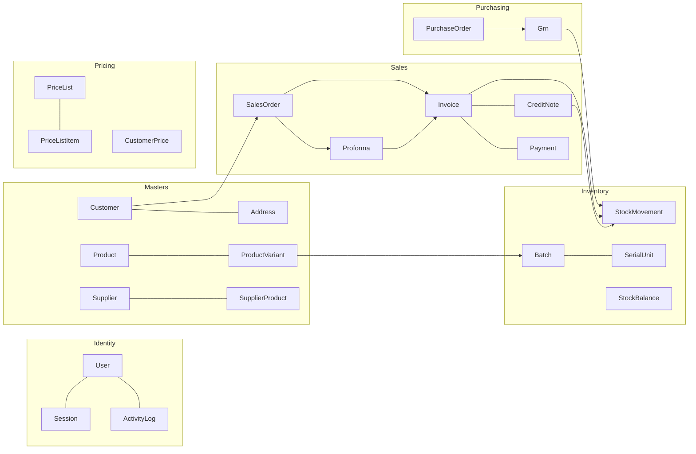
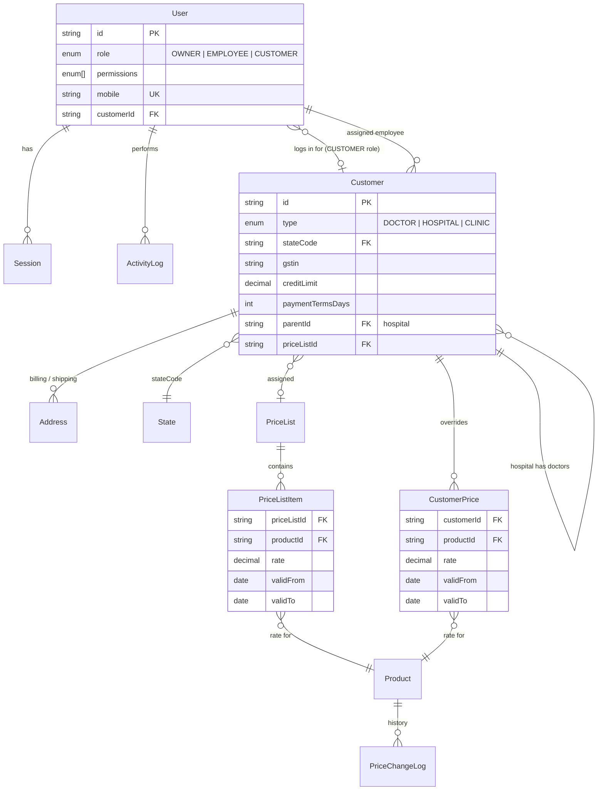
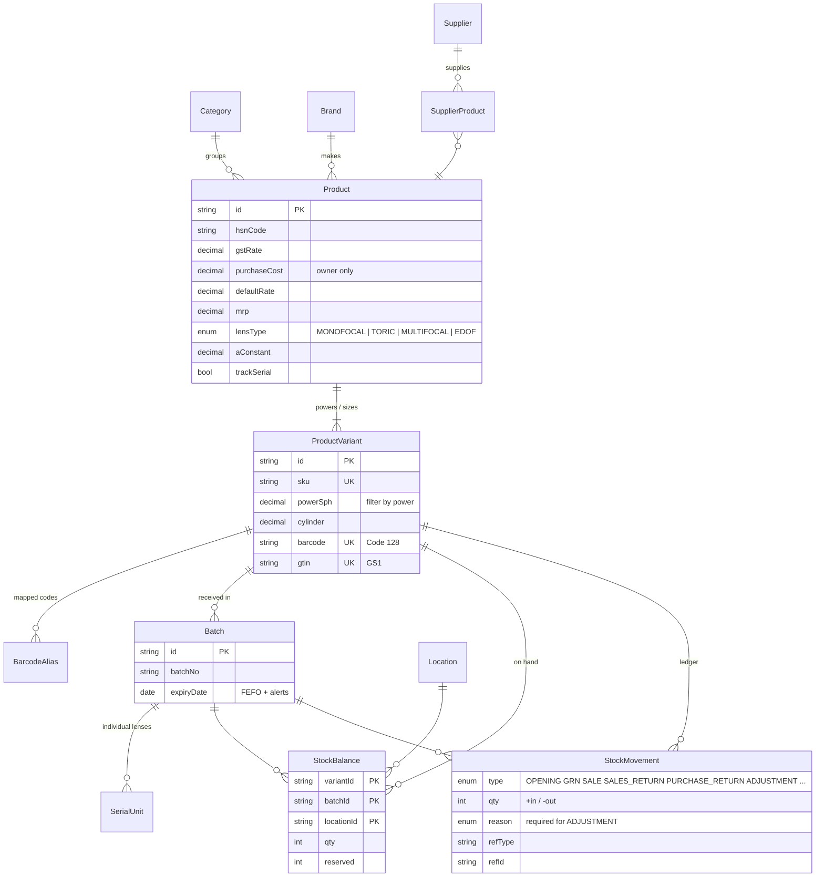
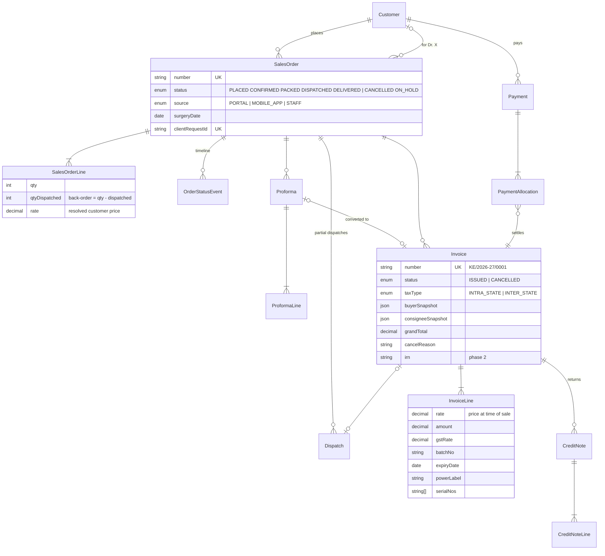
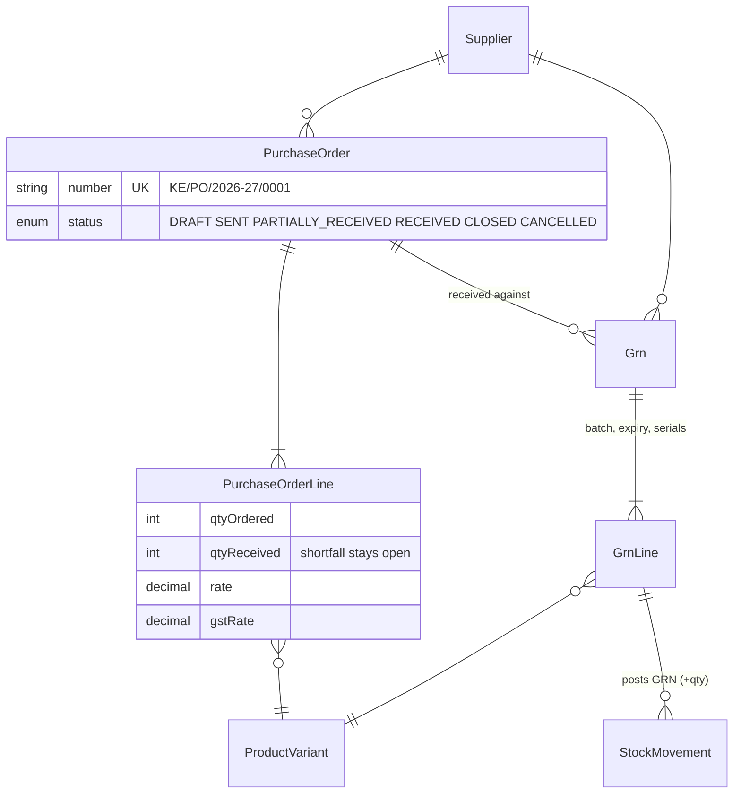
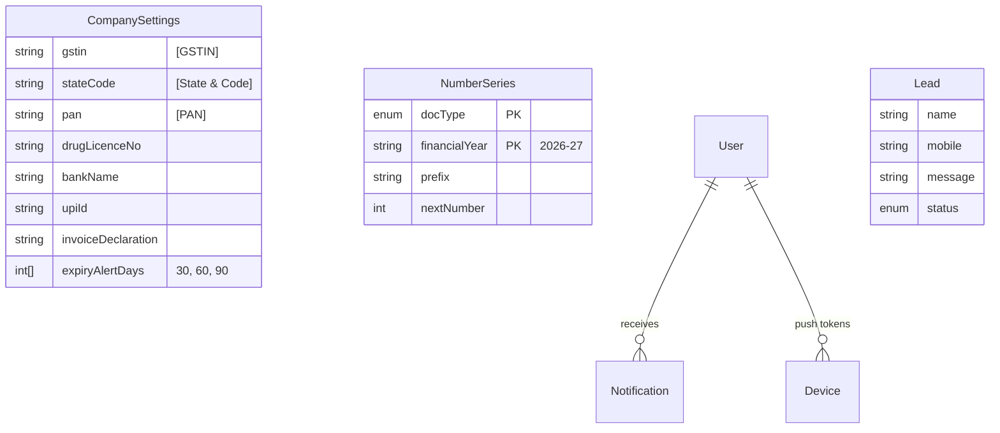

# (a) Database schema & ER diagram

The full schema is in [`packages/db/prisma/schema.prisma`](../packages/db/prisma/schema.prisma). It has 45 models, and its migrations are in `packages/db/prisma/migrations/`. The diagrams below are split by area so they stay readable. Only keys and the fields that matter for each diagram are shown.

## Design rules

| Rule | How the schema handles it |
|---|---|
| **One database for website, web app and mobile app** | A single PostgreSQL database. The three apps differ only in role and screens. |
| **Customer pricing: override → price list → default** | `CustomerPrice` (per customer per product) → `PriceListItem` (via `Customer.priceListId`) → `Product.defaultRate`. There is **one row per customer + product and per list + product**, each with an optional `validFrom`/`validTo` (calendar dates, inclusive). Outside that window the next level applies. An inactive price list is ignored. Prices are resolved on the **server** (`resolvePrice` in `packages/core`), so customers never receive other customers' rates or `purchaseCost`. |
| **Codes & barcodes** | `Product.code` is the base SKU, and variant SKUs extend it (`LV-HA600-+21.50`, toric `…-C2.25`). Internal Code 128 barcodes (`KE00000123`) and customer/supplier codes come from the `Counter` table, which is incremented atomically. `ProductVariant.gtin` stores the manufacturer GTIN as 14 digits. |
| **Old invoices keep old prices** | `InvoiceLine.rate`, `description`, `hsnCode`, `gstRate`, batch, expiry, power and serials are copied onto the line when it is saved. Buyer, consignee and supplier details are copied as JSON. Every rate change is also written to `PriceChangeLog`. |
| **Lens powers** | `Product` is the lens model (with its lens attributes and price). `ProductVariant` is one power (`powerSph`, `cylinder`, `addPower`) with its own stock and barcode. You filter by power on `ProductVariant.powerSph`. |
| **Batch / serial / expiry** | `Batch` holds the batch no. and expiry. `SerialUnit` is one physical lens with its status (in stock / sold / returned). Selling a lens records its serial on `InvoiceLine` so it can be traced in a recall. |
| **Stock ledger** | `StockMovement` is append-only (opening, GRN, sale, return, adjustment, transfer, cancel). `StockBalance` keeps the current quantity per variant + batch + location and is updated in the same transaction. A scan reads one indexed row, which keeps it under 300 ms. |
| **FEFO** | Picking sorts `StockBalance` joined to `Batch` by `expiryDate` and suggests the earliest batch that has not expired. |
| **Manufacturer barcodes** | `ProductVariant.gtin` matches GS1 GTINs directly. Any other code is mapped once in `BarcodeAlias`. The GS1 parser reads AI 01 (GTIN), 10 (batch), 17 (expiry) and 21 (serial). |
| **CGST+SGST vs IGST** | `Invoice.taxType` is set when the invoice is saved: if the company state code equals the place of supply (the buyer's or consignee's state) it is intra-state, otherwise inter-state. |
| **Numbering per financial year** | `NumberSeries(docType, financialYear)` has a prefix and a next number. The number is taken with `SELECT … FOR UPDATE`, so numbers never have gaps or duplicates. Examples: `KE/2026-27/0001`, `KE/PI/2026-27/0001`, `KE/PO/2026-27/0001`. |
| **Invoices are never deleted** | `InvoiceStatus` is only `ISSUED` or `CANCELLED`, with `cancelReason`, `cancelledBy` and `cancelledAt`. Cancelling writes `INVOICE_CANCEL` stock movements. Returns go through `CreditNote`. |
| **Ledger & ageing** | `Payment` + `PaymentAllocation` record which invoice each payment settles. Outstanding is `grandTotal − amountPaid − credit notes`. Ageing is worked out from `Invoice.dueDate`. |
| **Permissions on the server** | `User.role` plus `User.permissions[]` (one checkbox per permission). Every API route checks them. `ActivityLog` records who did what. |
| **Offline mobile** | Catalogue tables have `updatedAt` + `deletedAt` for delta sync. Orders and invoices created on the phone carry a `clientRequestId`, so a retry after a network drop never creates a duplicate. |

## Overview

## 1. Identity, customers & pricing

## 2. Catalogue, barcodes & inventory

## 3. Sales: orders → proforma → tax invoice → payments

## 4. Purchasing: PO → GRN → stock

## 5. Settings, numbering, notifications

